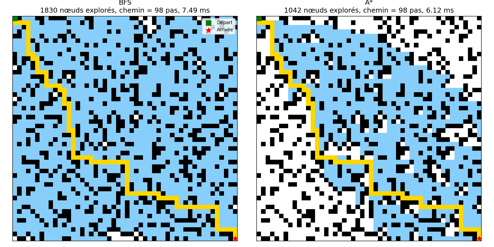

# Pathfinding : BFS vs A*

Comparaison d'un algorithme **exact** (BFS, parcours en largeur) et d'un algorithme **heuristique** (A*, distance de Manhattan) sur des grilles **2D** et **3D**.

Critères comparés : nombre de nœuds explorés, temps d'exécution, longueur du chemin trouvé.

TD d'Éthique de l'IA, ENSA Tanger, GINF 2.

## Installation et lancement

```bash
pip install -r requirements.txt
python main.py              # 2D + 3D
python main.py --mode 2d    # seulement 2D
python main.py --mode 3d    # seulement 3D
```

Les résultats sont écrits dans `results/tables/` (CSV) et `results/figures/` (images et visualisation 3D).

## Structure du projet

```
├── main.py              # point d'entrée
├── requirements.txt
├── src/
│   ├── grid.py          # grille 2D/3D, voisins, heuristique de Manhattan
│   ├── bfs.py           # algorithme BFS
│   ├── astar.py         # algorithme A*
│   ├── benchmark.py     # mesures (nœuds, temps, longueur)
│   └── visualization.py # grille 2D, nuage 3D, graphiques
├── results/
│   ├── tables/          # resultats_2d.csv, resultats_3d.csv
│   └── figures/         # visu_2d.png, visu_3d.html, barres_*.png
└── report/
    └── reponses.md      # réponses aux questions du TD
```

## Résultats 2D (25 % de murs, 4 voisins)

| Grille | Algo | Nœuds explorés | Temps (ms) | Longueur chemin |
|---|---|---|---|---|
| 20x20 | BFS | 304 | 1.09 | 38 |
| 20x20 | A* (Manhattan) | 161 | 0.79 | 38 |
| 20x20 | A* (Manhattan x2) | 82 | 0.42 | 38 |
| 50x50 | BFS | 1830 | 6.49 | 98 |
| 50x50 | A* (Manhattan) | 1042 | 5.15 | 98 |
| 50x50 | A* (Manhattan x2) | 214 | 1.09 | 104 |
| 100x100 | BFS | 7430 | 32.50 | 200 |
| 100x100 | A* (Manhattan) | 3093 | 18.76 | 200 |
| 100x100 | A* (Manhattan x2) | 313 | 2.03 | 222 |



## Résultats 3D (20 % de murs, 6 voisins)

| Grille | Algo | Nœuds explorés | Temps (ms) | Longueur chemin |
|---|---|---|---|---|
| 10x10x10 | BFS | 807 | 5.43 | 27 |
| 10x10x10 | A* (Manhattan) | 687 | 6.11 | 27 |
| 10x10x10 | A* (Manhattan x2) | 31 | 0.30 | 27 |
| 20x20x20 | BFS | 6347 | 43.45 | 57 |
| 20x20x20 | A* (Manhattan) | 5666 | 51.96 | 57 |
| 20x20x20 | A* (Manhattan x2) | 92 | 0.88 | 67 |
| 30x30x30 | BFS | 21632 | 143.12 | 87 |
| 30x30x30 | A* (Manhattan) | 19783 | 213.89 | 87 |
| 30x30x30 | A* (Manhattan x2) | 97 | 1.27 | 93 |

Visualisation 3D interactive : télécharger `results/figures/visu_3d.html` et l'ouvrir dans un navigateur.

Les temps varient selon la machine ; les nombres de nœuds et les longueurs sont reproductibles (graine fixe).

## Conclusion

- Avec une heuristique **admissible** (Manhattan), A* trouve le même chemin optimal que BFS en explorant moins de nœuds.
- Avec une heuristique **non admissible** (Manhattan x2), A* explore très peu de nœuds mais peut renvoyer un chemin plus long : on gagne en vitesse, on perd l'optimalité.
- En 3D avec beaucoup de murs, le gain de A* sur le nombre de nœuds est faible et le surcoût de la file de priorité le rend plus lent que BFS.

Les réponses détaillées aux questions du TD sont dans [`report/reponses.md`](report/reponses.md).
